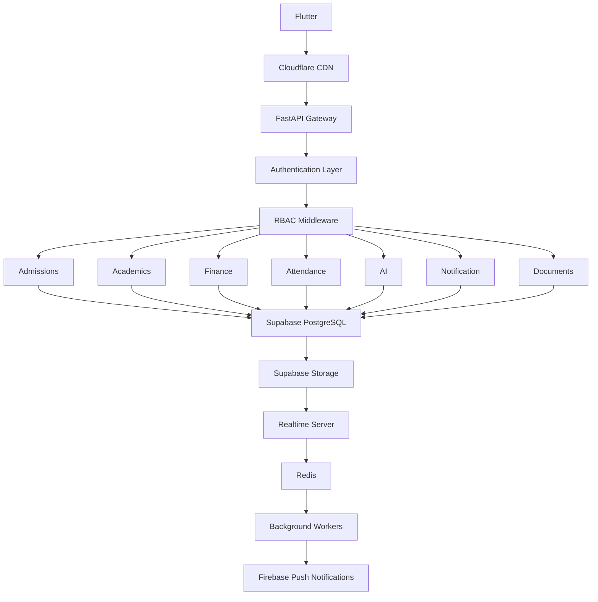

# EduOS — Education Operating System

A university **ERP + Learning Management System (LMS) + Student Information System (SIS) + Finance ERP + Communication Platform**.

With the stack chosen, this can absolutely become a production-grade SaaS product for schools and colleges.

## Tech Stack

- **Frontend:** Flutter (Android, iOS, Web)
- **Backend:** Python (FastAPI)
- **Database/Auth:** Supabase
- **Storage:** Supabase Storage
- **Realtime:** Supabase Realtime + WebSocket
- **Hosting:** Cloudflare VPS + Docker
- **UI Design:** Claude Code + Google Stitch
- **Notifications:** Firebase Cloud Messaging
- **Analytics:** PostHog / Supabase Analytics
- **Logging:** Sentry + OpenTelemetry

## Vision

> Instead of creating an app... create an entire **Education Operating System (EduOS)**.
>
> One platform. Different dashboards. Different permissions. Everyone works inside one ecosystem.

### Role Hierarchy

```
                  SUPER ADMIN

          ┌────────────┼─────────────┐
          │            │             │
      Management     Finance      Academic

      ┌─────┬──────┬─────┬───────────┐
      │     │      │     │           │
    HOD  Teacher Student Parent Security
```

## Modules

Think in modules.

- Authentication
- Dashboard
- Profile
- Admissions
- Student Information
- Attendance
- Timetable
- Assignments
- Homework
- Exams
- Marks
- Result
- Fees
- Library
- Transport
- Hostel
- Events
- Notices
- Circulars
- Documents
- Certificates
- Leave
- Messaging
- Chat
- AI Assistant
- Reports
- Analytics
- Complaint
- Inventory
- HR
- Payroll
- Settings
- Audit Logs
- Role Management

## Complete RBAC Structure

### 1. Student

> The student should never feel like they need another application. Everything is available.

#### Dashboard
- Today's Classes
- Attendance %
- Upcoming Exam
- Fee Due
- Announcements
- Assignments
- Recent Marks
- Upcoming Events
- Transport Status
- Hostel Notice
- Library Due
- Timetable
- Performance Graph

#### Academic
- Semester
- Subjects
- Faculty
- Credits
- CGPA
- Backlogs
- Attendance

#### Course Material
- Lecture Notes
- Videos
- PDFs
- Assignments

#### Practical
- Lab Records
- Projects
- Syllabus

#### Attendance
- Daily
- Monthly
- Semester
- Subject Wise
- Percentage
- Medical Leave
- Proxy Alerts
- Late Entry
- Attendance Graph

#### Assignments
- Pending
- Completed
- Submission
- Late Submission
- Grades
- Rubrics
- Teacher Feedback
- Attachments

#### Examination
- Internal
- External
- Practical
- Viva
- Exam Schedule
- Hall Ticket
- Seat Number
- Result
- Improvement Exam

#### Fees
- Fee Structure
- Pending
- Paid
- Online Payment
- Receipt
- Scholarship
- Refund
- Installment

#### Library
- Issued Books
- Return Date
- Fine
- Book Search
- Reserve Book
- Digital Library

#### Hostel
- Room Details
- Mess Menu
- Complaints
- Maintenance
- Visitor Entry

#### Transport
- Bus Tracking
- Driver Contact
- Pickup Time
- Attendance
- Route

#### Documents
- ID Card
- Bonafide
- Migration
- TC
- Marksheet
- Certificate
- Download PDF
- QR Verification

#### AI
- Ask Doubts
- Generate Notes
- Summarize PDF
- Exam Preparation
- Previous Papers

#### Profile
- Personal
- Guardian
- Medical
- Emergency
- Documents
- Password
- Biometrics

### 2. Teacher

> Teacher dashboard should reduce paperwork.

#### Dashboard
- Today's Schedule
- Pending Attendance
- Pending Assignment Checking
- Upcoming Exams
- Leaves
- Notifications
- Faculty Performance
- Student Alerts

#### Attendance
- Take Attendance
- QR Attendance
- Face Attendance
- Manual
- Bulk Upload
- Correction Request
- Late Entry

#### Assignments
- Create
- Edit
- Rubrics
- AI Evaluation
- Similarity Detection
- Feedback
- Bulk Marks

#### Lecture
- Upload Notes
- Videos
- PDF
- PPT
- Assignments
- Reference Material
- Record Lecture

#### Exams
- Question Bank
- Blueprint
- Internal Marks
- Practical Marks
- Moderation
- Result Approval

#### Student Performance
- Weak Students
- Top Students
- Attendance Risk
- Performance Analytics
- Recommendations

#### Communication
- Announcement
- Class Group
- One to One Chat
- Parent Communication
- Emergency Alerts

#### Leave
- Apply
- Approve Student Leave
- Compensation Class

### 3. HOD

> Department level control.

#### Department Dashboard
- Faculty Performance
- Attendance Statistics
- Department Results
- Placement

#### Research
- Labs
- Equipment
- Projects
- Budget

#### Faculty Management
- Assign Subjects
- Workload
- Department Timetable
- Leaves
- Performance Review
- Promotion Recommendation

#### Academic Monitoring
- Attendance Audit
- Assignment Audit
- Result Analysis
- Backlogs
- NAAC Reports
- NBA Reports

#### Approvals
- Question Paper
- Marks
- Attendance Correction
- Leave
- Projects
- Budget

#### Analytics
- Department Ranking
- Faculty KPI
- Student KPI
- Placement %
- Publication Count
- Research Grants

### 4. Finance

> This becomes almost a mini ERP.

#### Dashboard
- Today's Collection
- Pending Fees
- Scholarship
- Expenses
- Salary
- Budget
- Revenue
- Cash Flow

#### Fees
- Create Structure
- Discount
- Fine
- Refund
- Installment
- Online Payment
- Offline Payment
- Receipt
- GST

#### Accounting
- Ledger
- Journal
- Balance Sheet
- Profit Loss
- Income
- Expense
- Audit

#### Payroll
- Salary
- PF
- ESI
- Tax
- Increment
- Bonus
- Payslip

#### Vendor Management
- Purchase Orders
- Bills
- Payments
- Approval

#### Reports
- Daily Collection
- Outstanding
- Cash Book
- Bank Book
- Fee Analytics

### 5. Management

> Highest level insights.

#### Dashboard
- Admissions
- Revenue
- Attendance
- Placement
- Student Satisfaction
- Faculty Performance
- Growth

#### Analytics
- Admissions Funnel
- Retention
- Dropout
- Department Comparison
- Financial Trends
- Academic Trends
- Placement

#### Decision Support
- Budget
- Infrastructure
- Hiring
- Faculty Ratio
- Capacity Planning
- Demand Forecast

#### Approvals
- Budget
- Hiring
- Major Purchases
- Scholarship
- Policies

### 6. Super Admin

> Complete control.

#### Institution
- Campus
- Departments
- Courses
- Programs
- Semester
- Subjects
- Sections

#### User Management
- Students
- Teachers
- Parents
- Finance
- Management
- Admins

#### Permissions
- RBAC
- Roles
- Permission Matrix
- Custom Roles
- Dynamic Permissions

#### Configuration
- Branding
- Themes
- Logo
- Email
- SMS
- WhatsApp
- Payment Gateway
- SSO
- Google Login

#### Security
- Audit Logs
- Device Management
- Session Management
- IP Restriction
- 2FA
- Password Policy
- Encryption Keys

#### Infrastructure
- Backups
- Restore
- Health
- Logs
- Cron Jobs
- API Keys
- Storage
- CDN

#### AI Configuration
- LLM Provider
- Prompt Templates
- Usage Limits
- Moderation
- Cost Monitoring

## Parent Portal

> Should exist. Parents need:

- Attendance
- Fees
- Homework
- Teacher Chat
- Exam Results
- Transport
- Leave Approval
- Progress
- Notifications

## Notification System

- Push
- Email
- SMS
- WhatsApp
- In-App
- Priority
- Scheduled
- Broadcast
- Target Audience
- Read Receipt

## AI Features

> This is where your platform becomes different.

- AI Attendance Insights
- AI Marks Prediction
- Dropout Prediction
- Attendance Prediction
- Performance Prediction
- Question Paper Generator
- Lesson Planner
- Assignment Generator
- Rubrics Generator
- Auto Evaluation
- Transcript Generator
- Meeting Summarizer
- Student Chatbot
- Voice Assistant
- Career Recommendation
- Placement Readiness
- Resume Builder
- Interview Practice

## Reporting

- PDF
- Excel
- CSV
- Scheduled Reports
- Department Reports
- NAAC
- NBA
- UGC
- AICTE
- Government Reports

## Production Architecture



## Enterprise-Level Non-Functional Features

Beyond user-facing modules, a production-ready system should include:

- Multi-campus and multi-institute support
- Tenant isolation (SaaS architecture)
- Feature flags for institution-specific capabilities
- Offline-first support in Flutter with automatic sync
- Row-Level Security (RLS) in Supabase plus backend RBAC enforcement
- Comprehensive audit logs for every create/update/delete action
- Granular permission matrix (view/create/edit/delete/approve/export)
- Versioning for documents and academic records
- Automated backups and disaster recovery
- Monitoring, centralized logging, and alerting
- CI/CD pipelines with staging and production environments
- API versioning and OpenAPI documentation
- Rate limiting, API keys, and webhook support
- Localization (multiple languages) and accessibility
- Data import/export tools for ERP migration
- Automated testing (unit, integration, UI, and load testing)

## Suggested Development Roadmap

To keep the project manageable, build it in phases:

1. **Platform Foundation** – Authentication, RBAC, institution setup, user management, dashboards.
2. **Academic Core** – Student records, attendance, timetable, assignments, examinations, results.
3. **Administrative ERP** – Finance, HR, library, hostel, transport, inventory.
4. **Communication Layer** – Notifications, chat, announcements, document sharing.
5. **AI Layer** – AI assistant, grading, analytics, predictions, report generation.
6. **Enterprise & SaaS Features** – Multi-tenant support, analytics, integrations, monitoring, billing, and deployment tooling.
